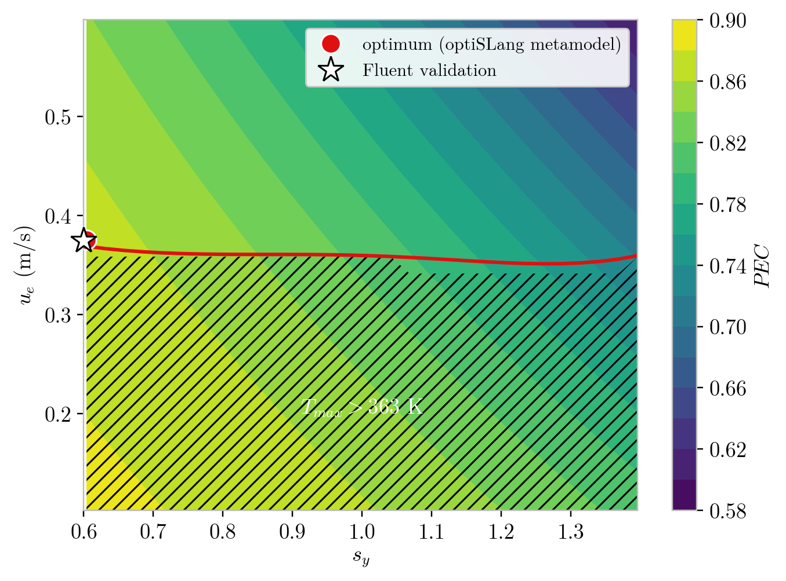

# Thermo-hydraulic optimization of a NEPCM micro-channel with a teardrop-shaped obstacle

2D CFD study (Ansys Fluent 2026 R1) coupled to an optiSLang optimization.
Question: does a passive teardrop-shaped obstacle, combined with nano-encapsulated phase change materials (NEPCM), improve the heat transfer / pressure drop trade-off of a heated micro-channel?

## Method
- 2D channel 10 × 1 mm, laminar and steady, 30 W/cm² on both walls, wall temperature limit 363 K
- Water + NEPCM: Maxwell conductivity, Batchelor viscosity, melting heat capacity, implemented in a UDF
- Obstacle shape changed by mesh morphing (stretch factors s_x, s_y)
- optiSLang AMOP: 100 designs, 4 parameters (φ, s_x, s_y, u_e), objective PEC

## Verification
- Fully developed Nu and Δp within 1 % of theory
- Mesh convergence: GCI below 0.2 %
- Metamodel: CoP above 0.98
- Optimum recomputed in Fluent: within 0.4 % of the prediction

## Main results
- The obstacle adds about 6 % heat transfer but multiplies the pressure drop by 1.7 to 4
- Best validated design: PEC = 0.865 (s_y = 0.6, u_e = 0.375 m/s)
- Obstacle height drives the trade-off; NEPCM fraction has little effect
- Tall, short obstacles cause wall separation and a local hot spot (+15 K)

Full report: [report/report.pdf](report/report.pdf)

## Repository
| Folder | Content |
|---|---|
| `report/` | report (PDF, LaTeX source, bibliography) |
| `figures/` | figures of the report |
| `data/` | 100 design points (`results.csv`), optiSLang exports, Fluent field exports |
| `udf/` | Fluent UDF for the NEPCM properties |

## Author
Mustafa Amine BENGA
